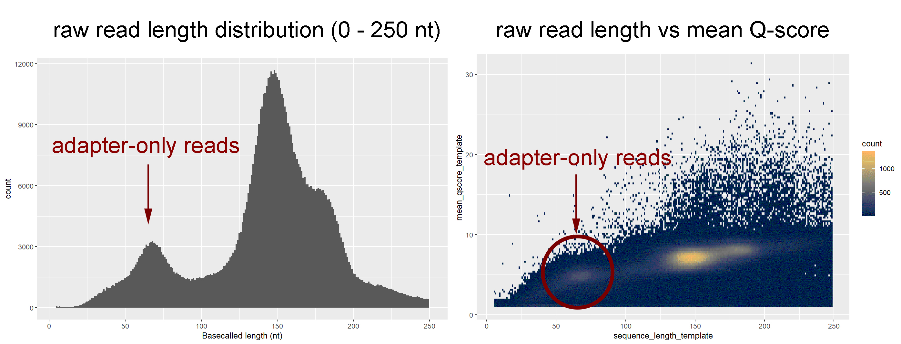

---
tags:
    - DRAP3R
    - Nanopore
    - DRS
    - Basecalling
    - Dorado
    - Bash

---

# Processing and analysis of DRAP3R datasets
---

## Overview

DRAP3R enables the capture and sequencing of nascent RNA Pol III-transcribed RNAs. This is achieved via a custom adapter that captures short poly(T) tailed RNAs of 4 nt or more. 
A full description of the method can be found [here](https://www.nature.com/articles/s41467-025-68230-1)

## Basecalling with Dorado and native RNA modification detection

Thus far, Dorado basecaller versions up to v2.1.2 have been tested and generally perform well. The key is to perform basecalling in super accuracy (sup) mode and to disable adapter trimming.
The reason for disabling adapter trimming is that without a poly(A) tail being present, Dorado cannot correctly identify the adapter-RNA boundary and this leads to significant overtrimming.
```
# example basecalling command with select native modification detection and no adapter trimming
/project/sysviro/dorado-2.1.2-linux-x64/bin/dorado basecaller --no-trim --rna-adapters -r sup,inosine_m6A_2OmeA,pseU_2OmeU $IN/$NAME/ > $OUT/"$NAME".mods.notrim.dorado.2.1.2.bam

# generate new sequencing summary file (based on (re)basecalled data)
/project/sysviro/dorado-2.1.2-linux-x64/bin/dorado summary $OUT/"$NAME".mods.notrim.dorado.2.1.2.bam > $OUT/"$NAME".sup-mods.notrim.dorado.2.1.2.sequencing_summary.txt

# extract raw read lengths (note: for dorado version prior to v2.0.0 use cut -f2,10 due to a change in column placement)
cut -f2,15 $OUT/"$NAME".sup-mods.notrim.dorado.2.1.2.sequencing_summary.txt > $OUT/"$NAME".sup-mods.notrim.dorado.2.1.2.id.length.txt

```
Note: the exact commands to disable adapter trimming can vary between versions so always verify the output is working as expected. This can best be achieved via plotting raw read length
distributions for a dataset that has been basecalled with and without adapter trimming.


## Preprocessing of basecalled data
The current *best practice* is to align basecalled reads against genome fastas using BWA MEM with optimized parameters. However, the combination of untrimmed adapter sequence in the reads
and the relaxed alignment parameters leads to all almost reads (inc. adapter-only reads) being aligned. While most alignments are likely accurate, those from adapter-only reads can bias
downstream analyses. The best option is thus to try and eliminate adapter-only reads via prefiltering. Note: It is hoped that the ongoing development of AVASARALA will provide an alternative
solution by enabling adapter trimming.



In the above plot, adapter-only reads show a raw read length peak of around 70 nt and generally have low median Q scores. Based on this, we consider all reads < 85 nt to be adapter-only
reads that should be removed prior to alignment. Note also that a small proportion of reads are extremely long (> 1 kb) and are considered to be ligation-derived artefacts. However, these
cannot be identified and split by Dorado and should be removed because BWA MEM cannot handle reads longer than ~1000 nt. Note also that BWA MEM cannot handle large numbers of reads when
using relaxed alignment parameters. Thus we have to split fastq files into smaller numbers and merge again at a later point.

```
# Convert uBAM to fastq for alignment while preserving modification tags (MM and ML) 
samtools fastq -TMM,ML $BASE/"$PREFIX".bam > $BASE/"$BASEFILE"

# Perform length filtering ussing bbtools
reformat.sh in=$BASE/$BASEFILE out=$BASE/$PREFIX.SR.fastq minlength=85 maxlength=999 overwrite=true 
reformat.sh in=$BASE/$BASEFILE out=$BASE/$PREFIX.LR.fastq minlength=1000 overwrite=true

# Split SR fastq files (containing reads of 85 - 1000 nt in length)
# Note: currently optimized for python v3.10.4
python /project/sysviro/bin/split_fastq-v1.1.py --reads_per_file 250000 $BASE/$PREFIX.SR.fastq $BASE/$PREFIX.SR.samp250k

```

## Alignment

Filtered reads should be aligned against a genome reference that has been indexed with BWA. A number of existing hybrid (human + virus) genome references are already available in `/project/sysviro/data/reference_genomes/Hybrid_genomes`. Note that genome-indexing only needs to be performed once for each hybrid genome reference.

Alignment is performed using BWA mem with optimized parameters and should be submitted as an array job specifying the number of *split fastq* files that result from the previous step e.g. `sbatch --array=1-4 alignment.sh`. The full code for alignment, extracting relevant statistics, parsing to sorted + indexed BAM files, and removing temporary files, is as follows.

```
# Perform BWA alignment
bwa mem -t 4 -W 13 -k 6 -T 20 -x ont2d $REF $BASE/"$PREFIX".SR.samp250k_${SLURM_ARRAY_TASK_ID}.fastq > $OUT/"$NAME"_bwa_W13k6T20.SR.250k-${SLURM_ARRAY_TASK_ID}.HG38-TB40.sam

# Extract alignment metrics from SAM files 
cut -f2 $OUT/"$NAME"_bwa_W13k6T20.SR.250k-${SLURM_ARRAY_TASK_ID}.HG38-TB40.sam | grep -v SN | sort | uniq -c > $OUT/"$NAME"_bwa_W13k6T20.SR.250k-${SLURM_ARRAY_TASK_ID}.stats.txt

# Convert SAM to co-ordinate sorted and indexed BAM
samtools view -bS $OUT/"$NAME"_bwa_W13k6T20.SR.250k-${SLURM_ARRAY_TASK_ID}.HG38-TB40.sam > $OUT/"$NAME"_bwa_W13k6T20.SR.250k-${SLURM_ARRAY_TASK_ID}.HG38-TB40.bam
samtools sort -o $OUT/"$NAME"_bwa_W13k6T20.SR.250k-${SLURM_ARRAY_TASK_ID}.HG38-TB40.sorted.bam $OUT/"$NAME"_bwa_W13k6T20.SR.250k-${SLURM_ARRAY_TASK_ID}.HG38-TB40.bam
samtools index $OUT/"$NAME"_bwa_W13k6T20.SR.250k-${SLURM_ARRAY_TASK_ID}.HG38-TB40.sorted.bam

# Cleanup to remove temporary files
rm $OUT/"$NAME"_bwa_W13k6T20.SR.250k-${SLURM_ARRAY_TASK_ID}.HG38-TB40.sam
rm $OUT/"$NAME"_bwa_W13k6T20.SR.250k-${SLURM_ARRAY_TASK_ID}.HG38-TB40.bam
```


### High-accuracy (vanilla) basecalling
For vanilla basecalling, the following setup is appropriate

```
IN=/project/sysviro/data/Nanopore-Pod5/
OUT=/project/sysviro/data/DoradoBasecalling/
filename=XXX

### Run basecalling (high accuracy mode, adapter trimming, BAM output)
/project/sysviro/dorado-0.9.0-linux-x64/bin/dorado basecaller --trim adapters -r $MODEL/rna004_130bps_hac@v3.0.1 $IN/path/to/pod5/ > $OUT/"$filename".hac.trimAdaptor.dorado.0.9.0.bam

### Generate sequencing summary file 
/project/sysviro/dorado-0.9.0-linux-x64/bin/dorado summary $OUT/$filename".hac.trimAdaptor.dorado.0.9.0.bam > $OUT/$filename".hac.trimAdaptor.dorado.0.9.0.sequencing_summary.txt

### Generate FASTQ file from BAM 
module load BEDTools 
bamToFastq -i $OUT/$filename".hac.trimAdaptor.dorado.0.9.0.bam -fq $OUT/$filename".hac.trimAdaptor.dorado.0.9.0.fastq
```

### Super-accuracy (modifications) basecalling
The latest RNA004 super high accuracy (sup) model allows for direct detection of various [RNA modifications](https://github.com/nanoporetech/dorado?tab=readme-ov-file#rna-models), including poly(A) tail estimates. Here
the preferred approach is to generated a single uBAM file where all modifications (inc. poly(A) tail length estimate) is calculated for each read.

STILL NEED TO UPDATE THE BELOW TO ALLOW FOR ALL MODS + TRANSFER OF ALL TAGS TO FASTQ

```
dorado basecaller --trim adaptor $MODEL/rna004_130bps_hac@v3.0.1 sample.pod5 --modified-bases m6A_DRACH > sample.bam
```

To go from an unaligned BAM file with modifications recorded in the MM and ML tags, it is necessary to convert to FASTQ while retaining the tags and then align to a reference using minimap2. This sounds complicated but in principal requires a single (piped) command. Note that SAMtools v1.16 or higher is needed along with minimap2 v2.26 or higher
```
samtools fastq -TMM,ML ${USAM} | minimap2 -x map-ont -a -t ${num_threads} -y --secondary=no ${REFERENCE} - > ${SAMFILE}

#e.g. 
samtools fastq -TMM,ML $OUT/EMC1-ARPE19-96h-1.sup-m6A.trimAdapters.dorado.0.5.1.bam | minimap2 -ax map-ont -L -p 0.99 -y --secondary=no /project/sysviro/data/reference_transcriptomes/VZV-Dumas-v2.0-complete.fasta - > /project/sysviro/users/Dan/VZVm6Atest/EMC1-ARPE19-96h-1.sup-m6A.tx.sam
```


